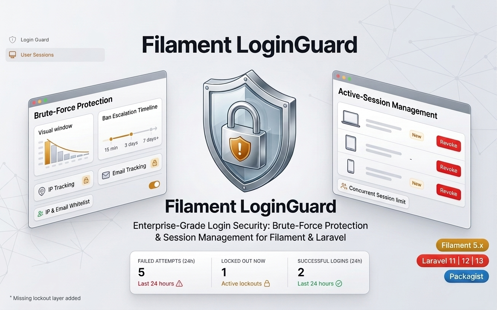
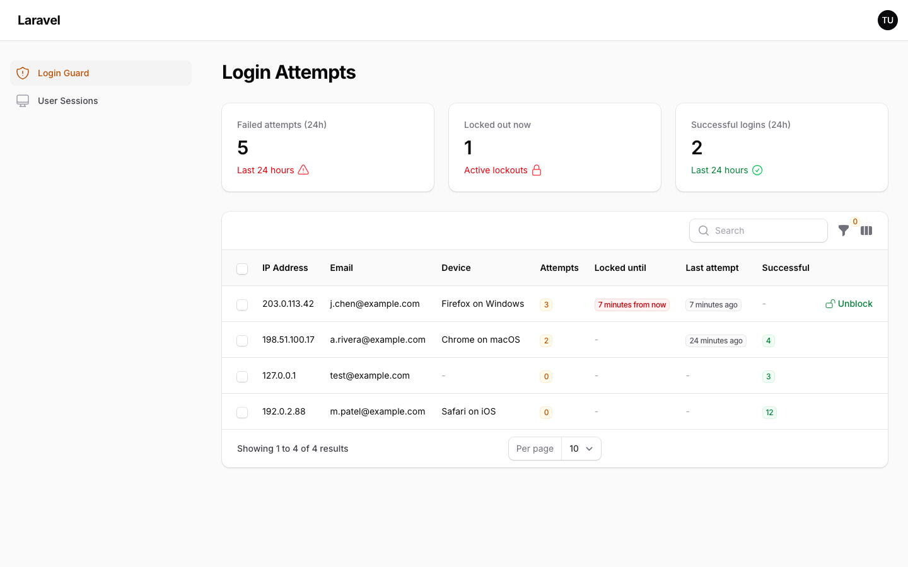
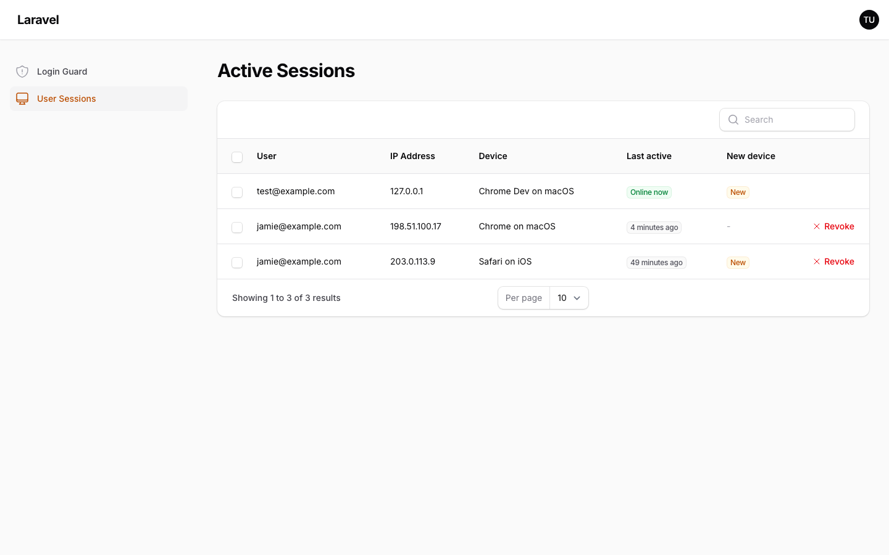

# Filament LoginGuard

[](https://github.com/solutionforest/filament-loginguard)

[](https://github.com/solutionforest/filament-loginguard/actions/workflows/tests.yml)
[](https://github.com/solutionforest/filament-loginguard/actions/workflows/phpstan.yml)
[](https://github.com/solutionforest/filament-loginguard/actions/workflows/fix-code-style.yml)


**Enterprise-grade login security for Filament and Laravel.**

Persistent brute-force protection with escalating IP and email lockouts, self-service unlock, active-session management and device recognition — plus a Filament admin UI to watch it all. IP intelligence (country / city / ASN) adds the signals that risk-based login will build on.

**[Changelog](CHANGELOG.md)** · **[Contributing](.github/CONTRIBUTING.md)** · **[Security policy](.github/SECURITY.md)**

## Why

Filament already throttles its login page at 5 attempts per minute per IP. That stops the simplest scripts, but it leaves real gaps:

- **No memory.** Throttling forgets everything every minute — an attacker can keep probing forever, just a little slower.
- **No per-account protection.** A bot rotating IPs can hammer one email address, and a bot rotating emails can hammer one IP.
- **No escalation.** Every minute looks the same, so a determined attacker is never really stopped.
- **No visibility.** You can't see who is attacking you, from where, or lock anyone out manually.

Filament LoginGuard adds the missing lockout layer on top of Filament's throttle: persistent tracking, escalating bans, per-email and per-IP protection, self-service unlock for the people caught in the crossfire, and an admin UI.

## Features

### Brute-force protection

- **Persistent tracking.** Failed attempts are recorded per (IP, email) pair — not per minute.
- **Escalating lockouts.** The first lockout lasts `initial_minutes`; the 2nd, 3rd and later ones step up through `escalation_hours` (e.g. 1 day, 3 days, 7 days+). The ladder lives in its own append-only table, so cleanup never resets it.
- **Cross-email and cross-IP aggregation.** With `tracking.per_ip`, the sum of attempts across all emails from one IP triggers an IP lockout — rotating emails doesn't help. `tracking.per_email` does the same across IPs for one email.
- **Attempt decay window.** Failures only accumulate inside the same `attempts_window_minutes` window; a slow drip just under the window length never reaches the threshold.
- **Whitelists.** IPs and emails that are never locked out. Localhost is whitelisted by default.
- **Self-service unlock.** The lockout email can carry a signed, single-use "unlock now" link, so a real owner can clear a lock without waiting (see [Limits](#limits)).
- **Admin notifications.** Email admins on every lockout, with a per-IP cooldown and optional queueing. A `LoginLockedOut` event fires too, for Slack / webhooks.
- **Proxy-aware.** Set `lockout.trusted_proxies` and the real client IP is read from `X-Forwarded-For`, so lockouts key on the client, not the CDN.

### Session management

- **Active-session listing** with a human-readable "last active" state and one-click revoke.
- **New-device detection.** Each login's browser + platform is fingerprinted; the first sighting is flagged and can email the account owner.
- **Concurrent-session limits.** Cap sessions per user; the oldest are evicted first.

### My Devices (self-service)

Every panel user gets a **My Devices** page in their user menu — no admin permission needed, and the query is always scoped server-side to the authenticated user:

- **This device** pinned on top.
- **Other signed-in devices**, each with **Sign out** and **"This isn't me"** (revokes that device's sessions *and* its identity).
- **Recently signed out**, collapsible, with **Forget device**.

Device identities are opaque cookie tokens: the browser holds a random token, the database stores only its SHA-256 hash, scoped per `guard + user model + user identifier`.

### IP intelligence (GeoIP enrichment)

A foundation layer that resolves the login IP to country / city / ASN / coordinates (MaxMind GeoLite2) and flags "new country / new ASN" per account. It **only produces signals** — it never blocks. Off by default; see [IP intelligence](#ip-intelligence).

### Admin interface

- **Login Attempts** page — inspect and unblock recorded attempts, with a **Country** badge per IP.
- **User Sessions** page — list and revoke active sessions.
- **Charts** — daily failure trend (7/30-day) and Top-10 attacked emails and IPs.
- **CSV export** — attempts and sessions, via Filament's export system.
- **Gate-based authorization** — every page and action can be gated independently.





## Requirements

| | Supported |
| --- | --- |
| PHP | 8.3, 8.4 |
| Laravel | 12, 13 |
| Filament | 5.8.3 or later |
| Database | Any Laravel-supported database (MySQL / MariaDB, PostgreSQL, SQLite, SQL Server) |
| Session driver | `database`, for session management and My Devices |
| Queue | Optional — for lockout emails and CSV export |
| Optional | `geoip2/geoip2` + MaxMind GeoLite2 files, for IP intelligence |

> Earlier Filament 5.x releases carry known security advisories — require at least 5.8.3. Laravel 11 is end-of-life and no longer supported.

Every combination of PHP and Laravel is tested on each push. See [Quality](#quality).

## Quick start

**1. Install the package**

```bash
composer require solution-forest/filament-loginguard
php artisan migrate
```

Migrations run automatically (`runsMigrations()`). Optionally publish the config:

```bash
php artisan vendor:publish --tag="filament-loginguard-config"
```

**2. Add the plugin to your panel** (for the admin pages)

```php
use SolutionForest\FilamentLoginGuard\FilamentLoginGuardPlugin;

public function panel(Panel $panel): Panel
{
    return $panel
        // ...
        ->plugin(FilamentLoginGuardPlugin::make());
}
```

The core protection works **without** registering the plugin — only the admin pages need it.

**3. Optional: enable IP intelligence**

```bash
composer require geoip2/geoip2
```

Then point the config at MaxMind GeoLite2 `.mmdb` files and set `ip_intel.enabled` to `true`. See [IP intelligence](#ip-intelligence).

### CSV export prerequisites

The CSV export buttons are built on [Filament's export system](https://filamentphp.com/docs/5.x/actions/export), which needs its own database tables. Fresh apps may be missing them — run:

```bash
php artisan make:queue-batches-table
php artisan make:notifications-table
php artisan vendor:publish --tag=filament-actions-migrations
php artisan migrate
```

Without these, the first export attempt fails with a "table not found" error (`exports`, `job_batches` or `notifications`). Exports also run through the queue, so a queue worker (or the `sync` driver) must be available.

## How it works

The package hooks into Laravel's core auth events rather than any specific UI, so it protects **every** login flow that goes through `Auth::attempt()` — native Laravel (Breeze, the starter kits), Filament, and custom controllers alike.

| Event | Action |
| --- | --- |
| `Illuminate\Auth\Events\Attempting` | If the IP or email is locked out, a `ValidationException` with the lockout message is thrown before any credential work. |
| `Illuminate\Auth\Events\Failed` | The failure is recorded for the (IP, email) pair. At the threshold, the IP and/or email is locked out and admins are notified. |
| `Illuminate\Auth\Events\Login` | A success resets the pair's counter and releases the email-scoped lock. IP-scoped locks stay, so one valid login can't unblock a shared or attacking IP. |

Social login (OAuth / Socialite) has no password to brute-force, so it doesn't fire `Attempting` / `Failed` — but it still fires `Login`, so success tracking and session management apply.

## IP intelligence

> [!NOTE]
> This is a **foundation layer**: it enriches logins with location/network signals and flags "new country / new ASN" per account. It **only produces signals** — it never blocks, challenges or otherwise changes the login flow. The signals are the input for the risk-based login and Geo/ASN blocking roadmap items.

### What gets recorded

On every failed and successful login, the package resolves the client IP against local MaxMind GeoLite2 databases and stores the result in the security event's `metadata`:

- `country` / `country_name` — ISO 3166-1 alpha-2 code and name
- `city` / `subdivision`
- `latitude` / `longitude` / `accuracy_radius_km`
- `asn` / `asn_organization` — autonomous system number and ISP name

On a successful login, two extra signals are computed against a per-account location history: `is_new_country` and `is_new_asn` — whether the account has not been seen from this country / ASN within `novelty_window_days`. The history lives in the `filament_loginguard_location_history` table (keyed by `guard + user type + user identifier`).

### Enabling it

The feature is **off by default** and optional — it needs the `geoip2/geoip2` package and the database files, which MaxMind's licence does not permit us to redistribute:

1. Install the reader package:

   ```bash
   composer require geoip2/geoip2
   ```

2. Obtain the database files. Two options — use `geoipupdate` to keep them current automatically (recommended for production), or download them manually from the account portal.

   **Option A — `geoipupdate` (recommended).** MaxMind's official updater. Create a `GeoIP.conf` with your account ID, license key and the editions you need:

   ```ini
   # /etc/GeoIP.conf
   AccountID YOUR_ACCOUNT_ID
   LicenseKey YOUR_LICENSE_KEY
   EditionIDs GeoLite2-Country GeoLite2-City GeoLite2-ASN
   DatabaseDirectory /var/www/storage/app/geoip
   ```

   ```bash
   geoipupdate
   ```

   Then schedule it with cron. City/Country are published every Tuesday & Friday, ASN every weekday, so a daily run covers everything:

   ```cron
   0 4 * * * /usr/local/bin/geoipupdate
   ```

   **Option B — manual download.** In the MaxMind account portal open **GeoIP / GeoLite → Download Files** and download the `GeoLite2-Country`, `GeoLite2-City` and/or `GeoLite2-ASN` archives in `.mmdb` (binary) format (GZIP/ZIP/SHA256), extract them, and place the `.mmdb` files somewhere private (e.g. `storage/app/geoip/`). Use *Show archived database files* for releases from the last 30 days.

   > [!WARNING]
   > The GeoLite EULA requires you to **keep the data up to date** — replace the databases within 30 days of each new release. Manual downloads won't remind you; `geoipupdate` + cron does it automatically.

   > [!NOTE]
   > Behind a firewall, allow outbound HTTPS (443) to `download.maxmind.com`, `updates.maxmind.com`, and — since downloads redirect to R2 presigned URLs — `mm-prod-geoip-databases.a2649acb697e2c09b632799562c076f2.r2.cloudflarestorage.com`. Your HTTP client must also follow redirects.

3. Point the config at them and switch it on:

   ```php
   // config/filament-loginguard.php
   'ip_intel' => [
       'enabled' => true,
       'databases' => [
           'country' => storage_path('app/geoip/GeoLite2-Country.mmdb'),
           'city' => storage_path('app/geoip/GeoLite2-City.mmdb'),
           'asn' => storage_path('app/geoip/GeoLite2-ASN.mmdb'),
       ],
       'novelty_window_days' => 90,
   ],
   ```

   Each database is independent — configure only what you have. `country` is the cheapest signal; `asn` is very stable; `city` also provides country plus coordinates.

4. Verify your setup:

   ```bash
   php artisan filament-loginguard:ip-intel:test
   php artisan filament-loginguard:ip-intel:test 8.8.8.8   # look up a specific IP
   ```

   The command reports the `enabled` flag, whether the `geoip2` package is installed, each database's path/state, and the resolved signals for the IP (exit code 0 on success, 1 when nothing resolves).

### Failure behaviour

IP intelligence is deliberately **fail-safe**. If it's disabled, the package is missing, the files are missing, or the IP is unmapped, `lookup()` returns `null` and the login proceeds exactly as before — location enrichment can never break authentication.

### Privacy

Resolved IP location is personal data. Before enabling, consider your obligations under GDPR / CCPA / local law:

- It is **off by default** — nothing is collected until you opt in.
- The raw IP is already stored by the lockout layer; this feature additionally stores a country code, city and ASN. Keep it scoped to what you need (e.g. country + ASN only, skipping `city` and coordinates).
- Treat `filament_loginguard_location_history` like your other security logs and define a retention policy for it.
- Disclose this in your privacy policy.

## Configuration

Behaviour is set in `config/filament-loginguard.php`, published with:

```bash
php artisan vendor:publish --tag="filament-loginguard-config"
```

Every option has a default and is documented inline. Here is the full published config, grouped into six sections — `lockout` (brute-force protection), `sessions` (active-session tracking), `devices` (device identity for My Devices), `ip_intel` (GeoIP enrichment), `maintenance` (optional auto-scheduling) and `pages` (admin page wiring):

```php
return [
    'lockout' => [
        'enabled' => true,                 // master switch
        'max_attempts' => 10,              // failures allowed inside the window before a lockout
        'initial_minutes' => 15,           // duration of the first lockout
        'escalation_hours' => [24, 72, 168], // 2nd, 3rd, 4th+ lockout durations; last value repeats
        'attempts_window_minutes' => 30,   // decay + aggregate counting window
        'trusted_proxies' => [],           // proxy/CDN IPs or CIDRs; X-Forwarded-For is honored for these

        'tracking' => [
            'per_ip' => true,              // aggregate attempts across emails per IP
            'per_email' => true,           // aggregate attempts across IPs per email
            'guards' => [],                // restrict to specific guards, e.g. ['web']; empty = all
        ],

        'whitelist' => [
            'ips' => ['127.0.0.1', '::1'],
            'emails' => [],
        ],

        'notifications' => [
            'enabled' => true,
            'mail' => [
                'to' => [],                // admin addresses; empty = no notifications
                'cooldown_minutes' => 60,  // at most one notification per IP per window
                'queue' => false,          // false = sync; queue name string = queued
            ],
            'self_unlock' => [
                'enabled' => false,        // mail a signed, single-use unlock link to the blocked address
                'link_ttl_minutes' => 60,  // how long the unlock link stays valid
                'queue' => false,          // false = sync; queue name string = queued
            ],
        ],
    ],

    // Active user sessions (requires SESSION_DRIVER=database).
    'sessions' => [
        'enabled' => true,                 // master switch for session security features
        'table' => 'sessions',
        'online_threshold_seconds' => 60,  // "online now" cutoff
        'user_model' => null,              // null = auth.providers.users.model
        'concurrent_limit' => null,        // max concurrent sessions per user; null = unlimited

        'new_device' => [
            'enabled' => true,             // @deprecated v0.7 — see devices.*
            'window_hours' => 24,          // sessions first seen within this window are flagged "New"

            'notifications' => [
                'enabled' => false,        // emails the account owner the first time a device is seen
                'mail' => [
                    'queue' => false,
                ],
            ],
        ],
    ],

    // Device identity (My Devices): opaque cookie tokens, hashed in the DB.
    'devices' => [
        'enabled' => true,                 // master switch for the device identity layer

        'cookie' => [
            'name' => 'filament_loginguard_device',
            'lifetime_days' => 365,
            'same_site' => 'lax',
        ],

        'retention_days' => 90,            // drop devices with no sessions after this many days (0 = keep)
        'max_devices_per_user' => 20,      // hard cap of device identities per account (0 = unlimited)

        'notifications' => [
            'new_device' => false,         // email the account owner on a new device sign-in
            'mail' => [
                'queue' => false,
            ],
        ],
    ],

    // IP intelligence (GeoIP enrichment): resolves the login IP against local
    // MaxMind GeoLite2 databases. Signals only — never blocks. Off by default.
    'ip_intel' => [
        'enabled' => false,                // master switch
        'databases' => [                   // local .mmdb paths; each optional
            'country' => null,
            'city' => null,
            'asn' => null,
        ],
        'novelty_window_days' => 90,       // "new country / ASN" lookback window
    ],

    'maintenance' => [
        'cleanup_attempts' => [           // delete stale attempt records
            'enabled' => false,           // false = schedule it yourself in routes/console.php
            'expression' => '0 0 * * *',  // cron expression (default: daily at midnight)
        ],

        'cleanup_sessions' => [           // delete expired session rows (needs SESSION_DRIVER=database)
            'enabled' => false,
            'expression' => '0 * * * *',  // cron expression (default: hourly)
        ],
    ],

    'pages' => [
        'attempts' => [
            'enabled' => true,
            'slug' => 'login-guard',
            'cluster' => null,             // optional Filament Cluster class-string to nest the page under
            'navigation_label' => null,    // null falls back to translations
            'navigation_icon' => 'heroicon-o-shield-exclamation',
            'navigation_group' => null,
            'navigation_sort' => null,
            'authorize' => null,           // gates everything; the finer keys below win when set
            'authorize_view' => null,      // viewing the page
            'authorize_unblock' => null,   // unblock / bulk-unblock actions
            'stats_widget' => true,        // show the failed-attempts / lockout stats widget
            'charts' => true,              // show the failure-trend & top-attacked charts
            'export' => true,              // allow CSV export of the attempts table
        ],

        'sessions' => [
            'enabled' => true,             // admin page only; session security uses sessions.enabled
            'slug' => 'user-sessions',
            'cluster' => null,
            'navigation_label' => null,
            'navigation_icon' => 'heroicon-o-computer-desktop',
            'navigation_group' => null,
            'navigation_sort' => null,
            'authorize' => null,
            'authorize_view' => null,      // viewing the page
            'authorize_revoke' => null,    // revoke / bulk-revoke actions
            'export' => true,              // allow CSV export of the sessions table
        ],

        // Self-service account security (no admin permission needed).
        'my_devices' => [
            'enabled' => true,
            'slug' => 'my-devices',
            'user_menu' => true,           // show "My Devices" in the user menu
            'navigation' => false,         // also list it in the panel navigation
            'navigation_label' => null,
            'navigation_icon' => 'heroicon-o-device-phone-mobile',
            'navigation_group' => null,
            'navigation_sort' => null,
        ],
    ],
];
```

### Authorization

> [!WARNING]
> Both admin pages are visible to **any authenticated panel user** by default. Restrict them with the `authorize` option, which accepts a permission/ability name checked via `$user->can(...)`. Use the split keys for finer control: `authorize_view` gates viewing, and `authorize_unblock` / `authorize_revoke` gate the security actions.

**With `spatie/laravel-permission`** (e.g. when using Filament Shield), the string is a permission name — create the permission and assign it to a role; no Gate is required:

```php
// config/filament-loginguard.php
'pages' => [
    'attempts' => ['authorize' => 'view-filament-loginguard', /* ... */],
    'sessions' => ['authorize' => 'view-filament-loginguard', /* ... */],
],
```

**Without spatie**, define a Gate for the ability in a service provider:

```php
// app/Providers/AppServiceProvider.php
Gate::define('view-filament-loginguard', fn (User $user) => $user->can('access-admin-settings'));
```

## Maintenance

Delete stale, expired attempt records (outside the decay window with no active lock):

```bash
php artisan filament-loginguard:cleanup-attempts
php artisan filament-loginguard:cleanup-attempts --all   # delete every record
```

Delete expired session rows (Laravel's session garbage collection is probabilistic, so rows from closed browsers can linger):

```bash
php artisan filament-loginguard:cleanup-sessions
php artisan filament-loginguard:cleanup-sessions --all   # delete every session
```

Schedule both in `routes/console.php`:

```php
use Illuminate\Support\Facades\Schedule;

Schedule::command('filament-loginguard:cleanup-attempts')->daily();
Schedule::command('filament-loginguard:cleanup-sessions')->hourly();
```

Alternatively, set `maintenance.cleanup_attempts.enabled` / `maintenance.cleanup_sessions.enabled` to `true` and the package registers them for you using each command's `expression` cron value.

## Quality

Every push runs [`tests.yml`](.github/workflows/tests.yml):

| Check | What it covers |
| --- | --- |
| Pest | 200+ tests on PHP 8.3 and 8.4 × Laravel 12 and 13 with Filament 5, and on the oldest supported Filament, 5.8.3 |
| PHPStan | Level 10, on `src`, `config` and `database` |
| Pint | Laravel's code style |

To run them yourself:

```bash
composer test        # Pest
composer analyse     # PHPStan
composer test:lint   # Pint
```

## Limits

- **Email lockouts can be abused as a denial-of-service vector.** An attacker who knows an account's email can deliberately fail logins to lock it out. Mitigate with self-service unlock, `whitelist.emails` for critical accounts, and a moderate `initial_minutes`. Behind a proxy/CDN, set `lockout.trusted_proxies` — otherwise everyone behind the proxy shares one IP.
- **Session management and My Devices require `SESSION_DRIVER=database`.**
- **CSV export needs Filament's export tables** (`exports`, `job_batches`, `notifications`) and a queue worker.
- **IP intelligence is opt-in and fail-safe**, and needs `geoip2/geoip2` plus MaxMind database files, which MaxMind's licence does not permit us to redistribute.

## Roadmap

Planned features, roughly in the order they are likely to land. Suggestions and PRs welcome.

- [ ] **Progressive response & CAPTCHA** — soften the cliff between "allowed" and "locked out" with a CAPTCHA step before the lockout.
- [ ] **Risk-based login (adaptive authentication)** — score every login from signals the package already collects and respond proportionally. *(The IP-intelligence foundation now ships and feeds this item.)*
- [x] **My devices** — self-service per-user device list with "This isn't me" revoke. *(shipped in v0.7.0)*
- [ ] **Geo / ASN blocking** — block or flag traffic by country or ASN. *(The GeoIP resolution foundation now ships; the block/flag rules are what's left.)*
- [x] **Charts widget** — failure trend and Top-10 leaderboards. *(shipped in v0.6.0)*
- [ ] **Slack / Telegram / Webhook notifications** — deliver lockout alerts beyond email.
- [ ] **Cloudflare integration** — push lockouts to the edge.
- [x] **CSV export** — export attempts and sessions for compliance audits. *(shipped in v0.6.0)*

## Changelog and versions

Releases follow [Semantic Versioning](https://semver.org), and every change is listed in [CHANGELOG.md](CHANGELOG.md).

## Contributing

Please see [CONTRIBUTING](.github/CONTRIBUTING.md) for details.

## Security vulnerabilities

Please review [our security policy](.github/SECURITY.md) on how to report security vulnerabilities.

## Credits

- [Solution Forest](https://github.com/solutionforest)
- [All Contributors](../../contributors)

## License

The MIT License (MIT). Please see [License File](LICENSE.md) for more information.
